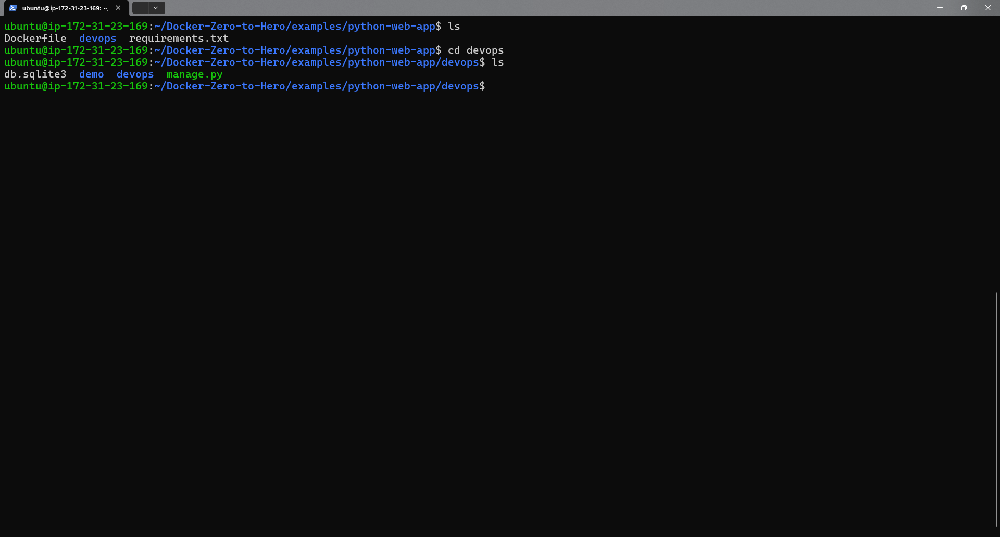
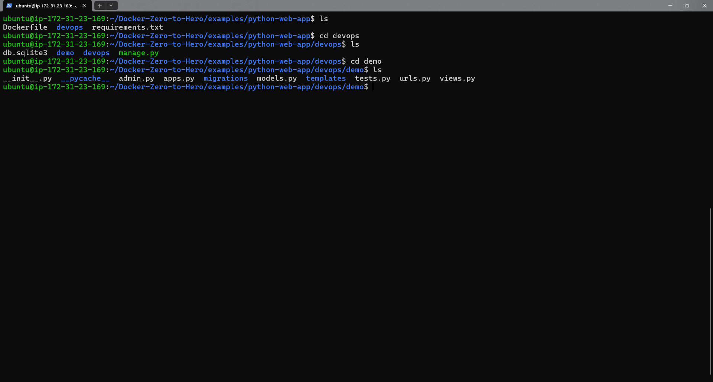
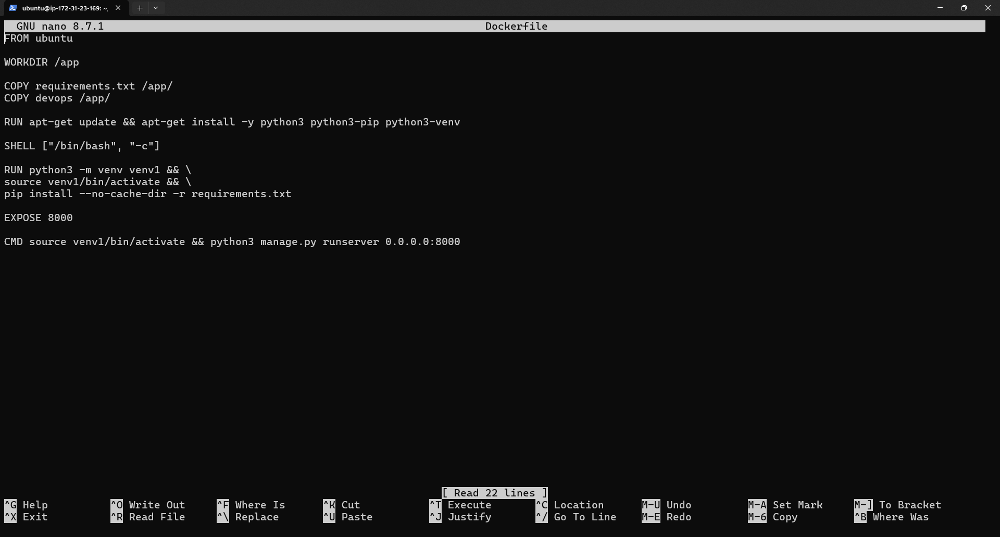
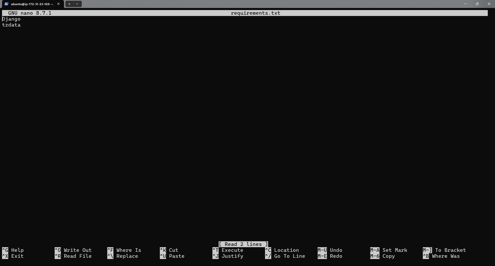
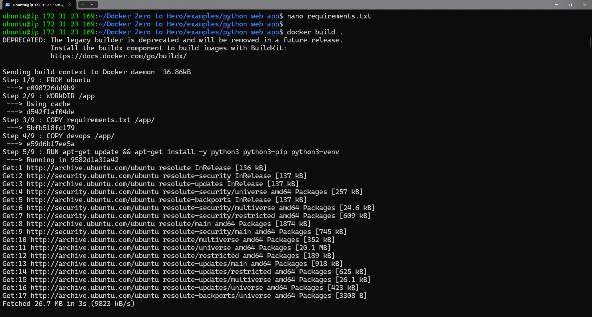
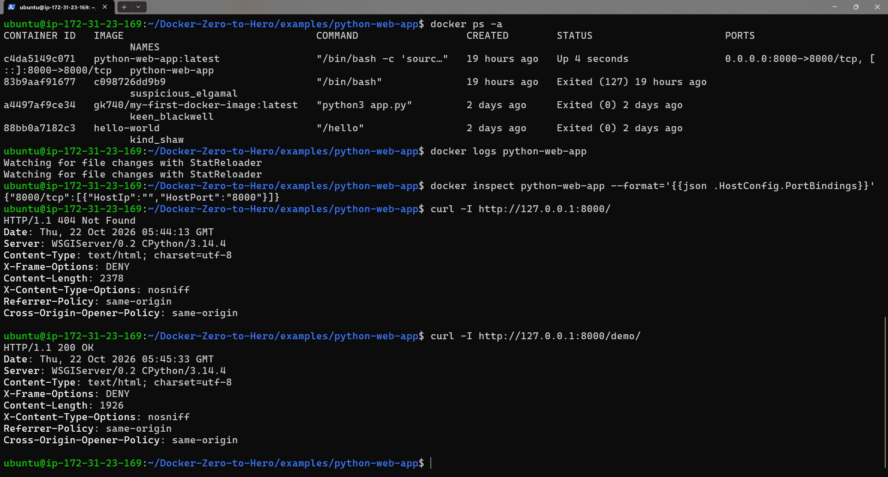
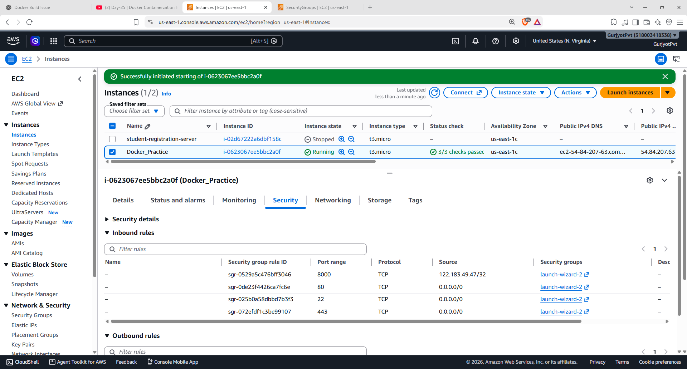
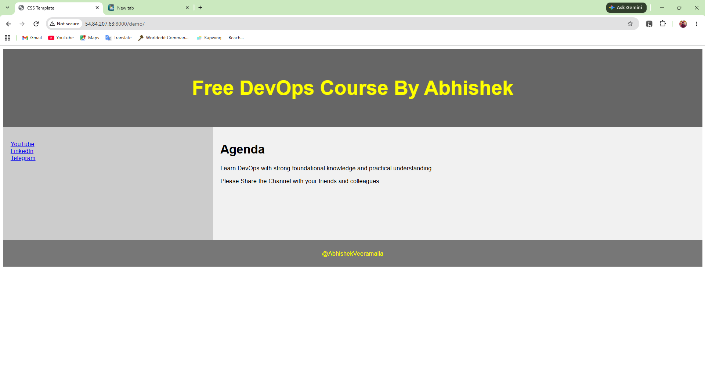

# Django Web Application Containerization with Docker

A hands-on DevOps project demonstrating how to containerize a Django web application using Docker and deploy it on an AWS EC2 instance.

This project follows **Day 25 of Abhishek's DevOps course** and covers Docker image creation, container execution, port mapping, and accessing a containerized web application through a browser.

## 📌 Project Overview

The objective of this project is to package a Django web application and its Python dependencies into a Docker image, then run it as a container on an AWS EC2 instance.

Docker helps provide a consistent application environment by packaging the application code, runtime dependencies, and startup configuration together.

### Key Highlights

- Containerized a Django web application using a custom Dockerfile.
- Used Ubuntu as the base image.
- Installed Python, pip, and Python virtual environment support.
- Installed Django dependencies using `requirements.txt`.
- Built and ran a Docker image on AWS EC2.
- Configured port mapping to expose the application on port `8000`.
- Verified the application using `curl` and a web browser.
- Configured AWS EC2 Security Group inbound rules for HTTP access on the application port.

## 🛠️ Technologies Used

| Technology | Purpose |
|---|---|
| Docker | Building images and running containers |
| Ubuntu | Base image for the application container |
| Python 3 | Application runtime |
| Django | Python web framework |
| AWS EC2 | Hosting the Docker container |
| AWS Security Groups | Controlling inbound network access |
| Linux / Bash | Server administration and Docker commands |
| Git & GitHub | Source code and project documentation |

## 📁 Repository Structure

```text
Docker_Hands-On/
└── Projects/
    └── Django_Containerization/
        ├── python-web-app/
        │   ├── Dockerfile
        │   ├── requirements.txt
        │   └── devops/
        │       ├── manage.py
        │       └── devops/
        │           ├── settings.py
        │           ├── urls.py
        │           └── ...
        │
        ├── screenshots/
        │   ├── Project_Directories.png
        │   ├── Demo_Folder_Files.png
        │   ├── Dockerfile_Content.png
        │   ├── requirements_content.png
        │   ├── Docker_Build_Django_App.png
        │   ├── Website_Status_Check.png
        │   ├── EC2_Instance_Custom_TCP_Setup.png
        │   └── Website_Working.png
        │
        └── README.md
```

*Note: The screenshot filenames above should match the actual files committed to the `screenshots/` directory. The Django project layout is based on the project files used in this exercise.*

## 🐳 Dockerfile Explained

The Dockerfile defines the instructions used to build the application image.

The main configuration includes:

- **Base image:** Ubuntu
- **Working directory:** `/app`
- **Application files:** Copies `requirements.txt` and the Django project into the image
- **System dependencies:** Installs Python 3, pip, and Python virtual environment support
- **Python dependencies:** Creates a virtual environment and installs packages from `requirements.txt`
- **Exposed port:** `8000`
- **Startup command:** Activates the virtual environment and starts Django's development server

The application is configured to listen on `0.0.0.0:8000` inside the container so it can receive traffic forwarded from the EC2 host.

## 🚀 Implementation Steps

### 1. Navigate to the Project Directory

On the EC2 instance, navigate to the application directory:

```bash
cd ~/Docker-Zero-to-Hero/examples/python-web-app
```

Verify the project files:

```bash
ls -la
```

### 2. Build the Docker Image

Build an image from the Dockerfile:

```bash
docker build -t python-web-app:latest .
```

Verify that the image was created:

```bash
docker images
```

The `-t` option assigns the image a name and tag, making it easier to identify and run.

### 3. Run the Docker Container

Start the Django application in detached mode and map port `8000` on the EC2 host to port `8000` in the container:

```bash
docker run -d \
  --name python-web-app \
  -p 8000:8000 \
  python-web-app:latest
```

Check the container status:

```bash
docker ps
```

View the application logs:

```bash
docker logs python-web-app
```

### 4. Verify the Application Locally on EC2

Send an HTTP request from the EC2 instance:

```bash
curl -I http://127.0.0.1:8000/demo/
```

The `/demo/` route returns `HTTP 200 OK` when the application is responding successfully.

### 5. Configure the EC2 Security Group

To access the application from your local computer:

1. Open the AWS EC2 console.
2. Select the EC2 instance running the container.
3. Open its associated Security Group.
4. Edit the inbound rules.
5. Add a Custom TCP rule for port `8000`.
6. Set the source to your public IP address for restricted access.

Avoid opening the application port to all IP addresses unless you specifically need public access and understand the security implications.

### 6. Access the Web Application

Open the following URL in your browser, replacing the placeholder with your EC2 instance's public IPv4 address:

```text
http://<EC2-PUBLIC-IP>:8000/demo/
```

The application page should load when the container is running, the port mapping is correct, and the Security Group permits access.

## 📸 Project Screenshots

The following screenshots document the implementation process.

### 1. Project Directory Structure



Shows the project directory and the Django application files.

### 2. Django Application Files



Shows the Django application structure, including Python modules, templates, and supporting files.

### 3. Dockerfile Configuration



Shows the Docker instructions used to create the application image.

### 4. Python Requirements



Shows the Python dependencies specified for the application.

### 5. Docker Image Build



Shows the Docker image build process on the EC2 instance.

### 6. Application Status and Verification



Shows the running container, configured port mapping, application logs, and HTTP response verification.

### 7. EC2 Security Group Configuration



Shows the EC2 Security Group inbound rules used to control access to the application.

### 8. Django Web Application Running



Shows the containerized Django web application successfully displayed in a browser.

## 🧠 Key Learnings

- Understanding the difference between a Docker image and a container.
- Writing a Dockerfile for a Python-based web application.
- Managing application dependencies during image creation.
- Using Docker image tags to identify application images.
- Running containers in detached mode.
- Mapping container ports to host ports.
- Checking container status and application logs.
- Testing HTTP endpoints with `curl`.
- Configuring AWS Security Groups for application access.
- Troubleshooting container startup and application URL routing.

## 🔧 Useful Docker Commands

| Command | Purpose |
|---|---|
| `docker build -t python-web-app:latest .` | Build the application image |
| `docker images` | List local Docker images |
| `docker ps` | List running containers |
| `docker ps -a` | List all containers |
| `docker start python-web-app` | Start an existing stopped container |
| `docker stop python-web-app` | Stop the container |
| `docker logs python-web-app` | View container logs |
| `docker inspect python-web-app` | Inspect container configuration |
| `docker rm python-web-app` | Remove a stopped container |
| `docker rmi python-web-app:latest` | Remove the image when no longer needed |

## ⚠️ Notes

- Ensure that the Docker daemon is running and the required permissions are configured on the EC2 instance.
- Use the Django URL `/demo/` for this project rather than assuming that the root URL `/` is configured.
- The `EXPOSE 8000` instruction documents the container port; the `-p 8000:8000` option publishes it on the host.
- The Django development server is intended for learning and testing, not production deployment.
- The image build and container run commands should be executed from the directory containing the Dockerfile.

## 🎯 Project Outcome

Successfully built a Docker image for a Django web application, ran it as a container on AWS EC2, mapped the application port, and verified access through HTTP requests and a web browser.

This hands-on exercise strengthens foundational DevOps skills in Docker containerization, Linux administration, AWS networking, and application troubleshooting.

---

**Project Category:** DevOps | Docker | AWS | Python | Django

**Learning Resource:** Abhishek's Complete DevOps Course — Day 25, Docker Containerization
